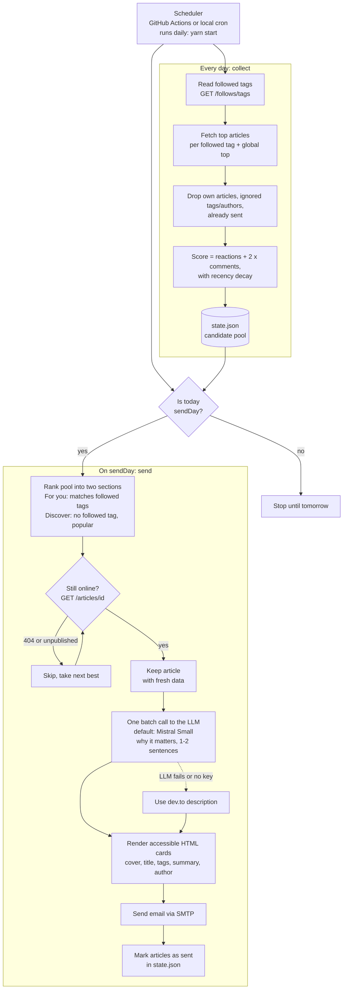

# devto-digest

[](https://github.com/thomasbnt/your-devto-digest/actions/workflows/digest.yml)
[](https://github.com/thomasbnt/your-devto-digest/actions/workflows/docker.yml)


[](LICENSE)

A weekly email digest of [dev.to](https://dev.to) articles, built from your own account:

- **For you**: popular articles in the tags you follow.
- **Discover**: popular articles *outside* your followed tags, to get out of your bubble.

Each article is a card with cover image, title, colored tag pills, author, and a one or two sentence blurb written by an open-weight LLM (Mistral Small by default) explaining why it is worth your time.

The script **collects every day** and **sends once a week**, so an article that peaks on Wednesday is not missed. Right before sending it re-checks each pick against the dev.to API and drops anything that is no longer online.

## Setup

### 1. Prerequisites

- Node.js >= 22.9
- Yarn 4, via Corepack
- A [dev.to](https://dev.to) account
- An SMTP account to send mail from (Gmail app password, Proton Bridge, Resend, Mailgun, your own server...)
- Optional: a [Mistral](https://console.mistral.ai) API key for the LLM blurbs. Without it the email still works and uses dev.to descriptions.

Enable Corepack
```bash
corepack enable
```

### 2. Install

Clone the repository
```bash
git clone https://github.com/thomasbnt/your-devto-digest.git
```

Go to the project
```bash
cd your-devto-digest
```

Install packages
```bash
yarn install
```

Create your environment file
```bash
cp .env.example .env
```

### 3. Get your keys and fill `.env`

| Variable | Where to get it |
| --- | --- |
| `DEVTO_API_KEY` | dev.to > *Settings > Extensions > DEV Community API Keys* |
| `LLM_API_KEY` | Mistral console > *API keys* (or any OpenAI-compatible provider, see [Switching model or provider](#switching-model-or-provider)) |
| `SMTP_HOST`, `SMTP_PORT`, `SMTP_USER`, `SMTP_PASS` | Your mail provider's SMTP settings. Port 465 uses TLS, 587 uses STARTTLS. |
| `MAIL_FROM`, `MAIL_TO` | Sender (`"devto-digest <you@example.com>"`) and recipient |

`.env` is git-ignored. Never commit it.

### 4. Tune `config.json` (optional)

Each section always shows an even number of cards (an odd pick is trimmed by one) so the 2-column grid has no orphan card. Set the digest `title`, the `sendDay`, how many articles per section, and tags or authors to ignore. The defaults work out of the box. See [Configuration](#configuration).

Tip: if you follow generic tags like `discuss` or `watercooler`, add them to `ignoreTags` so they do not crowd the "For you" section.

### 5. Run it

Build the candidate pool (takes about a minute)
```bash
yarn collect
```

Send the digest now, whatever the day
```bash
yarn send
```

For a hands-off setup, schedule `yarn start` daily with [GitHub Actions or cron](#automation).

## Testing

### Automated tests

Run the test suite (offline, no API key needed)
```bash
yarn test
```

It covers scoring, section ranking, the "still online" check, config precedence, LLM reply parsing, HTML escaping, and the email's accessibility rules (contrast of every color pair in light and dark, no white backgrounds, no underlined links).

### Try it on your real account without sending anything

Build the candidate pool (needs `DEVTO_API_KEY`)
```bash
yarn collect
```

Print the digest and write the preview (needs `LLM_API_KEY` to test the blurbs)
```bash
yarn dry-run
```

Open the preview in your browser (Linux)
```bash
xdg-open .preview/preview.html
```

Open the preview in your browser (macOS)
```bash
open .preview/preview.html
```

Check in the preview:

- light and dark theme (switch your OS or browser theme and reload)
- a narrow window (about 375px wide) for the mobile layout, and a window wider than 1200px for the 2-column grid
- no white background, tags shown as `#tag`, key words in bold in the blurbs

Nothing is sent and `state.json` is left untouched. The `.preview/` folder is git-ignored and for testing only: never commit it, it contains data from your account.

### Send a real test email

Safest first: catch the email locally with [Mailpit](https://mailpit.axllent.org) instead of a real mailbox.

Start Mailpit
```bash
docker run --rm -p 8025:8025 -p 1025:1025 axllent/mailpit
```

In `.env`, set `SMTP_HOST=localhost` and `SMTP_PORT=1025`, and leave `SMTP_USER` and `SMTP_PASS` empty.

Send the digest
```bash
yarn send
```

Open the Mailpit inbox at <http://localhost:8025>.

When it looks right, switch `.env` to your real SMTP settings and send again. Articles already sent are remembered for 60 days, so they do not come back in the next digest.

Replay a send while testing: reset the state
```bash
rm state.json
```

Rebuild the candidate pool
```bash
yarn collect
```

### Check the model and endpoint

Run the dry run and read the blurbs in the output
```bash
yarn dry-run
```

If the blurbs are just the dev.to descriptions, look for the log line `LLM summaries failed (...)` or `no LLM_API_KEY`. To try another model or a local one, see [Switching model or provider](#switching-model-or-provider).

## How it works



In short: a **daily** job keeps a fresh, scored pool so nothing is missed. A **weekly** job picks the best of that pool, verifies each article still exists, asks the LLM for a short blurb, and emails the result.

| Command | What it does |
| --- | --- |
| `yarn collect` | Reads your followed tags, fetches this week's top articles for each one plus the global top, scores them (reactions + 2x comments, gentle recency decay) and stores them in `state.json`. Re-run daily so scores stay fresh. |
| `yarn send` | Ranks the pool, checks each pick is still published (`GET /api/articles/{id}`), fills the slot with the next best if not, asks the LLM for blurbs, sends the email. Sent articles never come back (kept 60 days). |
| `yarn start` | Always `collect`, then `send` if today is `sendDay` and nothing was sent today. |
| `node app.js send-if-due` | Only the conditional send of `start`: sends if today is `sendDay` and nothing was sent today. Used by the workflow's `send` job, except for `force-send`, which calls `send`. |

Your own articles are excluded.

## Configuration

Edit [config.json](config.json). Secrets never go there.

| Key | Default | Meaning |
| --- | --- | --- |
| `title` | `Your dev.to digest {date}` | Email subject and heading. `{date}` becomes `YYYY-MM-DD`. |
| `sendDay` | `monday` | Weekday of the digest (server time, UTC on GitHub Actions). If it is missing, `null` or not a weekday, `monday` is used. |
| `accentColor` | `#690014` | Hex color (`#rgb` or `#rrggbb`) of the links and headings. In dark mode it is lightened automatically, and a color that is too light or too dark is adjusted to stay readable (WCAG AA). An invalid value falls back to the default. |
| `relevantCount` | `16` | Max cards in "For you". |
| `discoveryCount` | `8` | Max cards in "Discover". |
| `discoveryMinReactions` | `20` | Minimum reactions for a "Discover" article. |
| `discoveryMaxOverlap` | `null` | `null` = "Discover" shows the popular posts that share the fewest tags with yours, least first. Set a number to cap it (`0` = strictly outside your tags, may leave "Discover" short or empty if you follow many tags). |
| `lookbackDays` | `7` | How far back to look for articles. |
| `extraInterestTags` | `[]` | Treat these tags as followed too. |
| `ignoreTags` | `[]` | Never show articles with these tags. |
| `ignoreAuthors` | `[]` | Never show these usernames. |
| `summaryLang` | `en` | Language of the blurbs. |
| `llm.baseUrl` | `https://api.mistral.ai/v1` | OpenAI-compatible endpoint. |
| `llm.model` | `mistral-small-latest` | Model name. |

### Environment variables

| Variable | Required | Notes |
| --- | --- | --- |
| `DEVTO_API_KEY` | yes | |
| `LLM_API_KEY` | no | Alias: `MISTRAL_API_KEY`. Without it, dev.to descriptions replace the LLM blurbs. |
| `LLM_MODEL`, `LLM_BASE_URL` | no | Override `config.json`. |
| `SMTP_HOST`, `SMTP_PORT`, `SMTP_USER`, `SMTP_PASS` | to send | Port 465 uses TLS, others use STARTTLS when offered. |
| `MAIL_FROM`, `MAIL_TO` | to send | |
| `DRY_RUN` | no | `1` = no email, writes `.preview/preview.html` (git-ignored, test only, never commit it), leaves state untouched. |
| `CONFIG_PATH`, `STATE_PATH` | no | Default `./config.json`, `./state.json`. |

Precedence for the LLM settings: environment variable, then `config.json`, then built-in default.

## Switching model or provider

The app POSTs to `<baseUrl>/chat/completions` using the OpenAI-compatible format, so you only change two values.

A bigger Mistral model, in `.env`
```bash
LLM_MODEL=mistral-large-latest
```

Fully local with Ollama (no API key needed), in `.env`
```bash
LLM_BASE_URL=http://localhost:11434/v1
LLM_MODEL=mistral-small
```

Any other compatible server (vLLM, OpenRouter...), in `.env`
```bash
LLM_BASE_URL=https://openrouter.ai/api/v1
LLM_MODEL=mistralai/mistral-small
LLM_API_KEY=your-key
```

If the LLM call fails, the digest still goes out with the dev.to article descriptions.

## Automation

### GitHub Actions

[.github/workflows/digest.yml](.github/workflows/digest.yml) runs daily at 07:00 UTC and can be triggered by hand.

1. Fork this repo, or push it to your own GitHub repository (the workflow must be on the default branch, `main`).
2. Add the repository **secrets** in *Settings > Secrets and variables > Actions > New repository secret*: `DEVTO_API_KEY`, `LLM_API_KEY`, `SMTP_HOST`, `SMTP_PORT`, `SMTP_USER`, `SMTP_PASS`, `MAIL_FROM`, `MAIL_TO`.
3. Optionally add the repository **variables** `LLM_MODEL` and `LLM_BASE_URL` (same page, *Variables* tab).
4. Open the **Actions** tab, pick **devto-digest**, click **Run workflow** and choose a command:
   - `collect`: refreshes the candidate pool, sends nothing. Start here to check your keys.
   - `run`: collects, then sends only if today is `sendDay` and nothing was sent today. This is what the daily cron runs.
   - `force-send`: collects, then sends the digest now, whatever the day and even if one was already sent today.
5. A full run takes under 2 minutes. It shows two jobs, **collect** then **send**, so you can see which step failed. Open the run logs to check the result, then leave it alone: it runs by itself every day at 07:00 UTC.

With the [GitHub CLI](https://cli.github.com) you can set a secret without opening the browser (it asks for the value, so it stays out of your shell history)
```bash
gh secret set DEVTO_API_KEY
```

Trigger a run from the terminal
```bash
gh workflow run devto-digest --field command=collect
```

`state.json` is kept between runs with the Actions cache. A cache entry that is not used for 7 days is evicted, which a daily run prevents; if the cache is ever lost, the pool is rebuilt on the next run and the only side effect is that an already sent article may reappear. GitHub also pauses scheduled workflows on repos with no activity for 60 days: re-enable them from the Actions tab.

### Local cron

Edit your crontab
```bash
crontab -e
```

Add this line (daily at 07:00, adjust the path)
```bash
0 7 * * * cd /path/to/your-devto-digest && yarn start >> digest.log 2>&1
```

`yarn start` loads `.env` automatically.

## Accessibility

The email follows your client's theme: a light palette by default, a dark one when the client reports `prefers-color-scheme: dark`.

- No pure white and no transparent backgrounds in either theme: every block sets an explicit background and text color, so clients that invert or force a mode stay readable.
- All text/background pairs, in both themes and for every tag pill color, reach at least 4.5:1 contrast (WCAG AA). The test suite fails otherwise.
- Tags are always written out (`#tag`), color is decoration only.
- Links are bold-free, colored and not underlined by design; each card's title is the link, and the cover image links to the same article.
- Semantic headings, `lang`, `alt` text on images, 16px body text, single fluid column (images and cards use the full width, so it works on phones), and a full plain-text alternative.
- Font: Space Grotesk, loaded from the jsDelivr CDN (Fontsource, pinned version, no Google Fonts). Clients that block remote fonts, such as Gmail and some Outlook versions, fall back to the system sans-serif stack.
- Key words in each blurb are bolded by the LLM (`**word**` in its output, rendered as `<strong>`).

## Security notes

- Article text is treated as untrusted: it is HTML-escaped in the email, and the LLM prompt tells the model to ignore instructions found in articles and not to output URLs. Images and links are only used when they are `https://`.
- Secrets are read from the environment only. `.env` and `state.json` are git-ignored.

## Development

Run the tests
```bash
yarn test
```

See [CONTRIBUTING.md](CONTRIBUTING.md). Licensed under the [MIT License](LICENSE).

## Ideas for later

Not implemented, noted for a possible future version.

### Click tracking to learn what you actually read

Use the links you click in the digest to tune the next one. An email link is a plain GET request, so a static repository cannot record it: a small hosted endpoint is needed.

- **Tracking link**: each article link would point to a Cloudflare Worker, for example `https://your-worker.workers.dev/c/<token>`. The token holds the dev.to URL, the article id and its tags, signed with an HMAC secret known only to the digest. The Worker checks the signature (no forged clicks, no open redirect), records the click, then answers with a 302 redirect to dev.to.
- **Storage**: Workers KV, with only the minimum data (article id, tags, day), no IP and no user agent. Nothing is committed to a public repository. Each run, GitHub Actions or local cron fetches the clicks from a secret-protected `/export` endpoint.
- **Optional encryption**: the Worker would encrypt each click with a public key (ECDH P-256 and AES-GCM through WebCrypto), and only the private key, kept in a GitHub secret, could decrypt it during the run. Even if the storage leaks, nothing is readable. Metadata such as timing and volume would still be visible, and a leaked private key exposes the whole history.
- **Using the data**: a per-tag affinity score with time decay, a bonus for clicked tags in "For you", adjacent tags you do not follow yet favored in "Discover", suggestions of tags to follow, a share of random picks to avoid a filter bubble, and the recently clicked tags passed to the summary prompt.
- **Pitfalls**: Gmail, Proton and Apple Mail may prefetch links, so clicks too close to the send time or coming from bots must be ignored. It adds a hosted component to a project that has none today, so it would be opt-in (`tracking.enabled`, off by default).
- **Server-less alternative to check**: the dev.to API may expose your reading list, which is an interest signal that needs no tracking.

## About this project

This project comes from a human, [Thomas Bonnet](https://github.com/thomasbnt). AI helped with its design.
